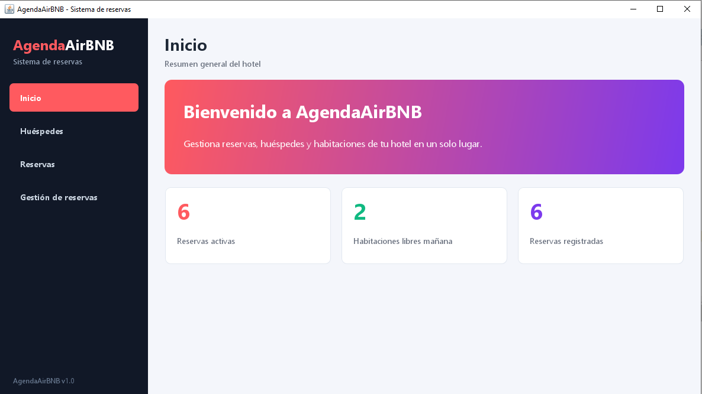
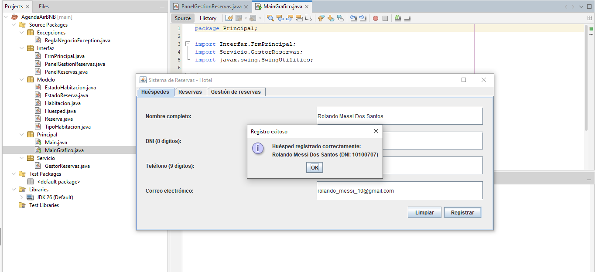
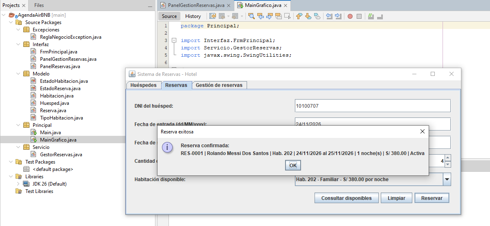

# 🏨 AgendaAirBNB

### Sistema de gestión de reservas hoteleras desarrollado en Java

**AgendaAirBNB** es una aplicación de escritorio desarrollada en Java para gestionar las reservas de un hotel, tomando como referencia un caso de negocio real.

El sistema busca mejorar el proceso de atención y administración de reservas mediante el registro de huéspedes, la consulta de habitaciones disponibles y la gestión de estadías, aplicando reglas de negocio para evitar reservas duplicadas y errores operativos.

El proyecto cuenta con dos modalidades de uso: una versión por consola y otra con interfaz gráfica desarrollada con Swing. Además, incorpora persistencia de información mediante MySQL.

## 🎯 Caso de negocio

Un hotel necesita una aplicación que permita administrar sus reservas de manera organizada y confiable.

Actualmente, el proceso presenta problemas como:

- Doble reserva de habitaciones para fechas coincidentes.
- Falta de visibilidad sobre las habitaciones disponibles.
- Dificultades para registrar y consultar huéspedes.
- Errores al cancelar o finalizar reservas.

**Solución propuesta:** desarrollar un sistema que centralice la información de huéspedes, habitaciones y reservas, aplicando validaciones y reglas de negocio para mejorar la gestión hotelera.

## ✨ Funcionalidades principales

1. **Registrar huéspedes:** almacenar los datos personales de los huéspedes.
2. **Consultar habitaciones disponibles:** filtrar habitaciones según fechas y capacidad.
3. **Crear reservas:** asignar una habitación a un huésped y calcular el importe según las noches.
4. **Cancelar reservas:** gestionar la cancelación de una reserva.
5. **Finalizar reservas:** actualizar el estado de las reservas al concluir una estadía.

## 📋 Reglas de negocio

El sistema aplica las siguientes reglas para mantener la integridad de las operaciones:

- El huésped debe registrar su nombre y DNI, compuesto por exactamente 8 dígitos numéricos.
- No se permite registrar dos huéspedes con el mismo DNI.
- Una habitación no puede tener dos reservas activas con fechas cruzadas.
- Cada huésped puede tener como máximo una reserva activa.
- Las habitaciones pueden encontrarse en estado `Disponible` o `Reservada`.
- La fecha de salida debe ser posterior a la fecha de entrada.
- La disponibilidad debe considerar tanto el rango de fechas como la capacidad de la habitación.
- El sistema valida las operaciones y muestra mensajes de confirmación o error.

## 🧩 Historias de usuario y criterios de aceptación

### HU-01: Registrar huésped

**Como** recepcionista, **quiero** registrar a un huésped con su nombre, DNI, teléfono y correo, **para** poder asignarle reservas.

- **CA-01 (correcto):** Dado que el recepcionista ingresa datos válidos y el DNI no está registrado, cuando presiona "Registrar", entonces el sistema guarda al huésped y muestra un mensaje de confirmación.
- **CA-02 (error):** Dado que el recepcionista ingresa un DNI que no tiene exactamente 8 dígitos numéricos, cuando presiona "Registrar", entonces el sistema no guarda al huésped y muestra el mensaje "El DNI debe tener exactamente 8 dígitos numéricos."
- **CA-03 (error):** Dado que ya existe un huésped con ese DNI, cuando presiona "Registrar", entonces el sistema no guarda el registro y muestra un mensaje de DNI duplicado.

### HU-02: Consultar habitaciones disponibles

**Como** recepcionista, **quiero** consultar las habitaciones libres según las fechas y la cantidad de personas, **para** ofrecer solo opciones reales y evitar dobles reservas.

- **CA-04 (correcto):** Dado que se ingresan fechas válidas y la cantidad de personas, cuando se presiona "Consultar", entonces el sistema muestra solo las habitaciones con capacidad suficiente y sin reservas activas cruzadas en esas fechas.
- **CA-05 (error):** Dado que la fecha de salida es igual o anterior a la de entrada, cuando se presiona "Consultar", entonces el sistema muestra el mensaje "El rango de fechas no es válido."
- **CA-06 (error):** Dado que ninguna habitación cumple los criterios, cuando se presiona "Consultar", entonces el sistema muestra "No hay habitaciones disponibles para esos criterios."

### HU-03: Crear reserva

**Como** recepcionista, **quiero** crear una reserva para un huésped en una habitación y un rango de fechas, **para** confirmar su estadía y comunicarle el total a pagar.

- **CA-07 (correcto):** Dado que el huésped está registrado, no tiene otra reserva activa y la habitación está libre en esas fechas, cuando se confirma la reserva, entonces el sistema genera un código (RES-0001), calcula el total según las noches y marca la habitación como Reservada.
- **CA-08 (error):** Dado que la habitación ya tiene una reserva activa que se cruza con las fechas elegidas, cuando se intenta confirmar, entonces el sistema rechaza la reserva y muestra "La habitación ya está reservada en esas fechas."
- **CA-09 (error):** Dado que el huésped ya tiene una reserva activa, cuando intenta crear otra, entonces el sistema la rechaza y muestra "El huésped ya tiene una reserva activa."

## 🛠️ Tecnologías utilizadas

| Tecnología | Aplicación |
|---|---|
| Java | Lenguaje principal para la lógica y desarrollo del sistema. |
| Swing | Desarrollo de la interfaz gráfica de escritorio. |
| MySQL 8 | Almacenamiento persistente de la información. |
| JDBC | Conexión entre la aplicación Java y MySQL. |
| NetBeans IDE 32 | Entorno de desarrollo. |
| Git y GitHub | Control de versiones y gestión del código fuente. |

## Interfaz gráfica

La aplicación incluye una interfaz Swing con barra lateral de navegación y cuatro secciones:
**Inicio**, **Huéspedes**, **Reservas** y **Gestión de reservas**.



- Tema visual centralizado en la clase `Tema` (colores, fuentes y estilos reutilizables).
- Tarjetas de resumen en la pantalla de inicio con reservas activas, habitaciones libres y reservas registradas.
- Tablas con encabezado oscuro, filas alternadas y estado de la reserva en colores.

## 🏗️ Arquitectura del proyecto

El proyecto está organizado por responsabilidades para separar la lógica de negocio, los modelos, la interfaz y el acceso a datos.

```text
             USUARIO
                |
                v
       +-------------------+
       |     INTERFAZ      |
       |                   |
       |  Consola / Swing  |
       +-------------------+
                |
                v
       +-------------------+
       |     SERVICIO      |
       |                   |
       |  GestorReservas   |
       |  Reglas de negocio|
       +-------------------+
                |
                v
       +-------------------+
       |    PERSISTENCIA   |
       |                   |
       |     JDBC          |
       |   Repositorios    |
       +-------------------+
                |
                v
       +-------------------+
       |       MySQL       |
       |                   |
       |   Base de datos   |
       +-------------------+
```

**Responsabilidad de las principales capas:**

- **Modelo:** representa las entidades y estados del sistema, como huéspedes, habitaciones y reservas.
- **Servicio:** concentra la lógica de negocio y las validaciones mediante `GestorReservas`.
- **Interfaz:** permite interactuar con el sistema mediante consola o ventanas gráficas Swing.
- **Persistencia:** administra la conexión con MySQL y las operaciones de almacenamiento mediante JDBC y repositorios.
- **Excepciones:** permite gestionar errores relacionados con las reglas de negocio.

## 🗄️ Base de datos MySQL

El sistema utiliza **MySQL 8** para almacenar la información de manera persistente.

La estructura de la base de datos se crea automáticamente al iniciar la aplicación, de acuerdo con la implementación del proyecto.

**Componentes de persistencia:**

- `ConexionBD`: administra la conexión con la base de datos.
- Repositorios por entidad: gestionan las operaciones de acceso a los datos.
- `mysql-connector-j`: permite la comunicación entre Java y MySQL mediante JDBC.

### Configuración de la base de datos

1. Instalar MySQL Server 8 y MySQL Workbench.
2. Abrir MySQL Workbench y ejecutar el script `database/crear_base_datos.sql` utilizando el usuario correspondiente.
3. Revisar el script y configurar correctamente las credenciales de acceso.
4. Copiar `config.example.properties` y crear un archivo llamado `config.properties`.
5. Ingresar las credenciales de MySQL en el archivo de configuración.
6. Verificar que el servicio MySQL esté iniciado y ejecutar la aplicación.

**Importante:** `config.properties` está incluido en `.gitignore`, por lo que las credenciales locales no deben publicarse en GitHub.

El conector JDBC `mysql-connector-j` se encuentra en la carpeta `lib/`.

## 📸 Evidencias del proyecto

El proyecto cuenta con capturas de las principales funcionalidades de la aplicación.

### Registro de huéspedes



### Creación de reservas



### Gestión de reservas


## 📂 Estructura del proyecto

La organización principal del código fuente es la siguiente:

```text
src/
├── Excepciones/
│   └── ReglaNegocioException
│
├── Modelo/
│   ├── Huesped
│   ├── Habitacion
│   ├── Reserva
│   ├── TipoHabitacion
│   ├── EstadoHabitacion
│   └── EstadoReserva
│
├── Servicio/
│   └── GestorReservas
│
├── Interfaz/
│   ├── FrmPrincipal
│   ├── PanelReservas
│   └── PanelGestionReservas
│
├── Persistencia/
│   ├── ConexionBD
│   └── Repositorios por entidad
│
└── Principal/
    ├── Main
    └── MainGrafico

database/
└── crear_base_datos.sql

evidencias/
├── huespedes.png
├── reservas.png
└── gestion.png

lib/
└── mysql-connector-j

config.example.properties
```

## 🚀 Cómo ejecutar el proyecto

### Requisitos previos

- JDK 17 o superior (probado con JDK 26).
- Apache NetBeans IDE 32.
- MySQL Server 8.
- MySQL Workbench.

### Pasos de ejecución

**1. Clonar el repositorio**

```bash
git clone https://github.com/angelcaldasdev/AgendaAirBNB.git
```

**2. Abrir el proyecto en NetBeans**

Seleccionar:

`File > Open Project`

Buscar la carpeta del repositorio y abrir el proyecto.

**3. Configurar MySQL**

Seguir los pasos de la sección [Base de datos MySQL](#-base-de-datos-mysql).

**4. Ejecutar la aplicación**

El proyecto ofrece dos modalidades:

| Archivo | Modalidad |
|---|---|
| `Principal/Main.java` | Aplicación por consola. |
| `Principal/MainGrafico.java` | Aplicación gráfica con Swing. |

Para ejecutar una modalidad, ubicar el archivo correspondiente en NetBeans, hacer clic derecho y seleccionar **Run File**.

### Configuración de codificación UTF-8

Si los caracteres con tildes se muestran incorrectamente en la consola, ingresar a:

`Project Properties > Run > VM Options`

Agregar:

```text
-Dfile.encoding=UTF-8 -Dstdout.encoding=UTF-8 -Dstderr.encoding=UTF-8
```

## 🗺️ Próximas mejoras

Entre las mejoras previstas para continuar evolucionando el proyecto se encuentran:

- Incorporar pruebas unitarias con JUnit.
- Fortalecer el manejo de transacciones en las operaciones de reservas.
- Desarrollar reportes de ocupación e ingresos del hotel.
- Mejorar los mecanismos de validación y gestión de errores.
- Migrar progresivamente la aplicación hacia Spring Boot.
- Ampliar la arquitectura para facilitar futuras integraciones.

## 👨‍💻 Autor

**Angel Caldas**

Estudiante de Ingeniería de Sistemas Computacionales | Desarrollador Full Stack.

Interesado en el desarrollo de software, programación Java, aplicaciones web y soluciones digitales orientadas a resolver problemas reales.

Actualmente enfocado en fortalecer mis conocimientos en Java, Spring Boot, Angular, TypeScript y bases de datos.

### 🔗 Conecta conmigo

- 💼 [LinkedIn](https://www.linkedin.com/in/angel-rafael-caldas-ocmin-930b1a151/)
- 🐙 [GitHub](https://github.com/angelcaldasdev)

---

🏨 **AgendaAirBNB: organizando reservas, optimizando procesos y aplicando tecnología a problemas reales.**

*Proyecto de práctica desarrollado en Java con enfoque en programación orientada a objetos, reglas de negocio y persistencia de datos.*