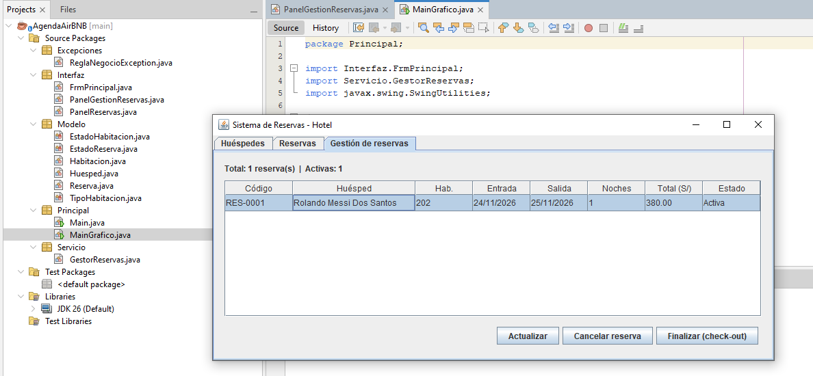

# AgendaAirBNB

Sistema de reservas estilo Airbnb para un hotel, desarrollado en Java (NetBeans).
Proyecto de práctica basado en un caso de negocio real.

## Caso de negocio

El hotel necesita una aplicación para gestionar sus reservas. Actualmente existen
problemas de doble reserva, falta de visibilidad de habitaciones disponibles y
errores al cancelar o finalizar reservas.

## Funcionalidades principales

1. Registrar huésped
2. Consultar habitaciones disponibles
3. Crear reserva
4. Cancelar o finalizar reserva

## Reglas de negocio

- El huésped debe registrar su nombre y DNI (exactamente 8 dígitos numéricos).
- Una habitación no puede tener dos reservas con fechas cruzadas.
- Cada huésped puede tener máximo una reserva activa.
- Las habitaciones pueden estar en estado Disponible o Reservada.
- La fecha de salida debe ser posterior a la fecha de entrada.
- El sistema debe validar las operaciones y mostrar mensajes de confirmación o error.

## Tecnologías

- Java
- NetBeans IDE 32
- Git y GitHub

## Estado del proyecto

Funcional en consola y con interfaz gráfica (Swing). Próximo paso: persistencia de datos.

## Historias de usuario y criterios de aceptación

### HU-01: Registrar huésped
**Como** recepcionista, **quiero** registrar a un huésped con su nombre, DNI, teléfono y correo, **para** poder asignarle reservas.

- **CA-01 (correcto):** Dado que el recepcionista ingresa datos válidos y el DNI no está registrado, cuando presiona "Registrar", entonces el sistema guarda al huésped y muestra un mensaje de confirmación.
- **CA-02 (error):** Dado que el recepcionista ingresa un DNI que no tiene exactamente 8 dígitos numéricos, cuando presiona "Registrar", entonces el sistema no guarda al huésped y muestra el mensaje "El DNI debe tener exactamente 8 dígitos numéricos."
- **CA-03 (error):** Dado que ya existe un huésped con ese DNI, cuando presiona "Registrar", entonces el sistema no guarda el registro y muestra un mensaje de DNI duplicado.

### HU-02: Consultar habitaciones disponibles
**Como** recepcionista, **quiero** consultar las habitaciones libres según las fechas y la cantidad de personas, **para** ofrecer solo opciones reales y evitar dobles reservas.

- **CA-04 (correcto):** Dado que se ingresan fechas válidas y la cantidad de personas, cuando se presiona "Consultar", entonces el sistema muestra solo las habitaciones con capacidad suficiente y sin reservas activas cruzadas en esas fechas.
- **CA-05 (error):** Dado que la fecha de salida es igual o anterior a la de entrada, cuando se presiona "Consultar", entonces el sistema muestra el mensaje "El rango de fechas no es válido."
- **CA-06 (error):** Dado que ninguna habitación cumple los criterios, cuando se presiona "Consultar", entonces el sistema muestra "No hay habitaciones disponibles para esos criterios."

### HU-03: Crear reserva
**Como** recepcionista, **quiero** crear una reserva para un huésped en una habitación y un rango de fechas, **para** confirmar su estadía y comunicarle el total a pagar.

- **CA-07 (correcto):** Dado que el huésped está registrado, no tiene otra reserva activa y la habitación está libre en esas fechas, cuando se confirma la reserva, entonces el sistema genera un código (RES-0001), calcula el total según las noches y marca la habitación como Reservada.
- **CA-08 (error):** Dado que la habitación ya tiene una reserva activa que se cruza con las fechas elegidas, cuando se intenta confirmar, entonces el sistema rechaza la reserva y muestra "La habitación ya está reservada en esas fechas."
- **CA-09 (error):** Dado que el huésped ya tiene una reserva activa, cuando intenta crear otra, entonces el sistema la rechaza y muestra "El huésped ya tiene una reserva activa."

## Cómo ejecutar

Requisitos: JDK 17 o superior (probado con JDK 26) y NetBeans.

1. Clona el repositorio: `git clone https://github.com/angelcaldasdev/AgendaAirBNB.git`
2. Ábrelo en NetBeans con **File > Open Project**.
3. Elige una de las dos versiones (clic derecho sobre el archivo > **Run File**):
   - `Principal/MainGrafico.java`: versión con interfaz gráfica (Swing).
   - `Principal/Main.java`: versión con menú por consola.

Si las tildes se ven mal en la consola, en **Project Properties > Run > VM Options** agrega:
`-Dfile.encoding=UTF-8 -Dstdout.encoding=UTF-8 -Dstderr.encoding=UTF-8`

## Capturas

### Registro de huéspedes

### Creación de reservas

### Gestión de reservas

## Estructura del proyecto

    src/
    ├── Excepciones/   ReglaNegocioException
    ├── Modelo/        Huesped, Habitacion, Reserva, TipoHabitacion, EstadoHabitacion, EstadoReserva
    ├── Servicio/      GestorReservas (lógica de negocio)
    ├── Interfaz/      FrmPrincipal, PanelReservas, PanelGestionReservas
    └── Principal/     Main (consola), MainGrafico (Swing)

## Próximas mejoras

- Persistencia de datos (los datos hoy se guardan solo en memoria).
- Reportes de ocupación e ingresos.
- Migración a Spring Boot con base de datos.
